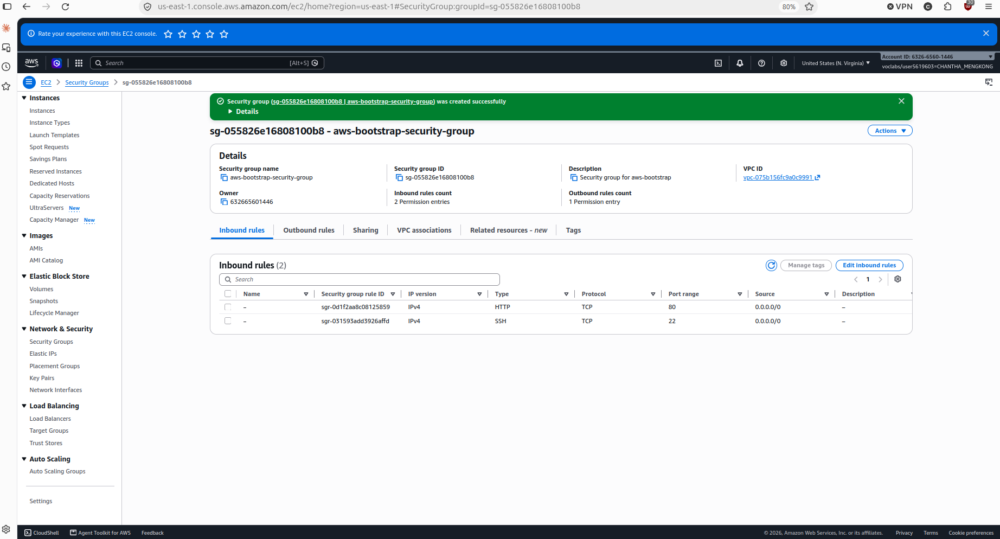
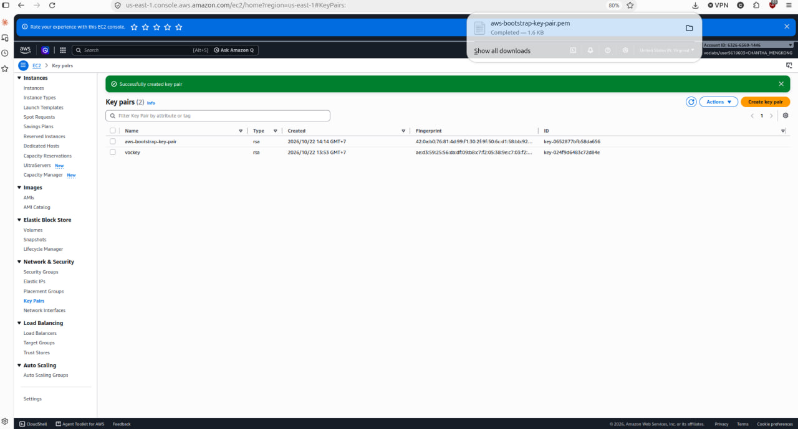
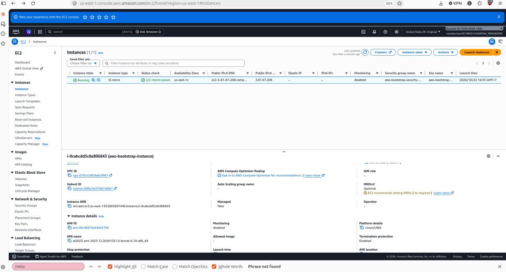
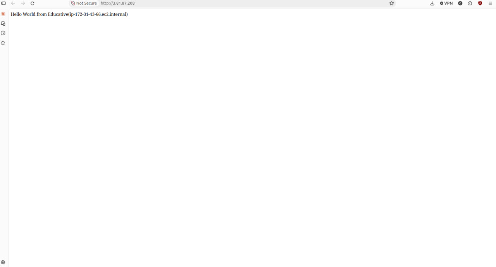
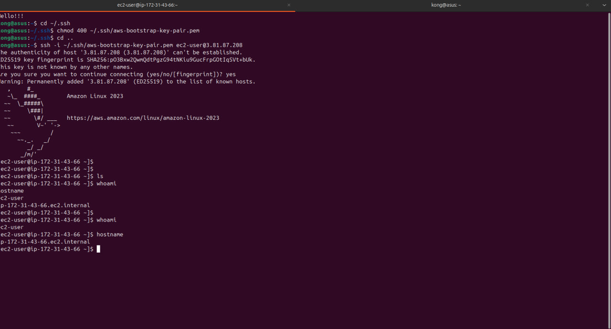
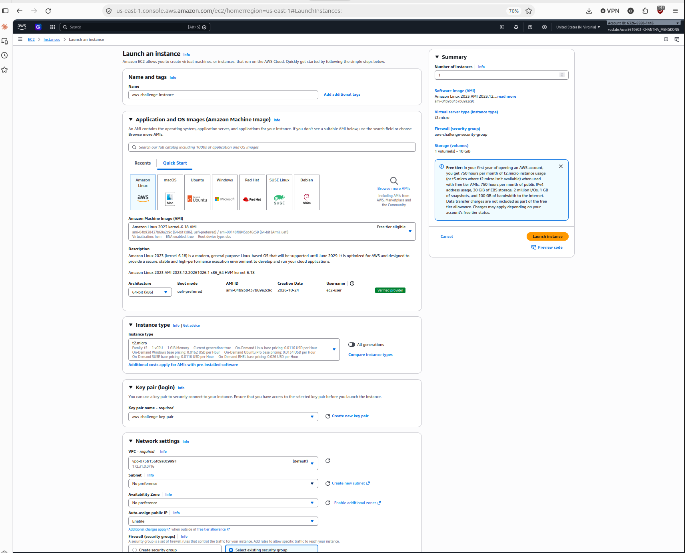
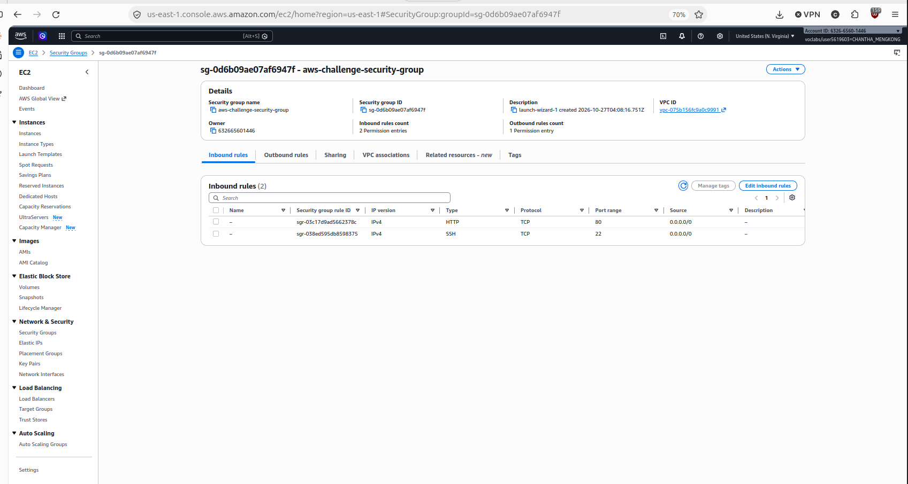
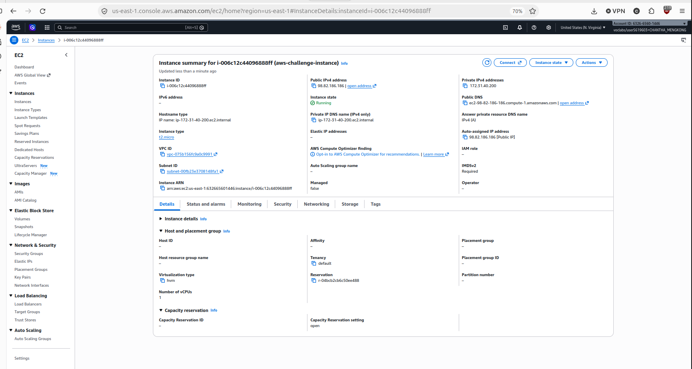
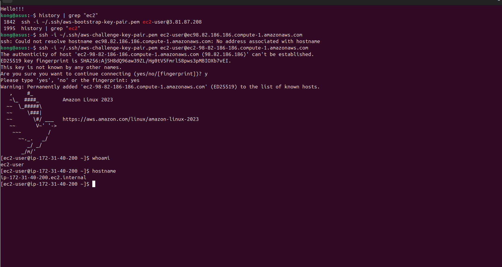

## Student name: CHANTHA Mengkong
## Student ID: 202221526
## Learner Lab username: voclabs/user5619063=CHANTHA_MENGKONG
## Date completed: 27.10.2026

# Cloud Lab 1 — Amazon EC2

All work was done in the AWS Academy Learner Lab, Region **US East (N. Virginia) `us-east-1`**.

### Part 1.1 — An Amazon EC2 Walkthrough

In this part I created a security group and a key pair, launched an EC2 instance that installs a web server with a user data script, and tested it from a browser and over SSH.

#### Security group

In **EC2 → Network & Security → Security Groups**, I clicked **Create security group** and set:

- Name: `aws-bootstrap-security-group`
- Description: `Security group for aws-bootstrap`
- VPC: the default VPC
- Inbound rules:
  - **SSH** (TCP 22), source **Anywhere-IPv4** (`0.0.0.0/0`), for remote login
  - **HTTP** (TCP 80), source **Anywhere-IPv4** (`0.0.0.0/0`), for web traffic from the browser
- Outbound rules: the default rule (all traffic allowed)
- Tag: `Name = aws-bootstrap-security-group`

A security group works as a firewall at the instance level. Without these two inbound rules, the browser and the SSH client could not reach the instance.



#### Key pair

In **EC2 → Network & Security → Key Pairs**, I clicked **Create key pair** and set:

- Name: `aws-bootstrap-key-pair`
- Key pair type: **RSA**
- Private key file format: **.pem** (for OpenSSH)

AWS keeps the public key and the browser downloaded the private key `aws-bootstrap-key-pair.pem`. Amazon Linux instances do not use passwords, so this private key is what proves my identity when I log in over SSH. I kept the `.pem` file in `~/.ssh/`, outside the repository; `.gitignore` blocks `*.pem` files.



#### Instance details

In **EC2 → Instances → Launch instances**, I configured the instance:

| Setting | Value |
|---|---|
| Name | `aws-bootstrap-instance` |
| AMI | Amazon Linux 2023 AMI, 64-bit (x86) |
| Instance type | `t2.micro` |
| Key pair | `aws-bootstrap-key-pair` |
| Network | Existing security group `aws-bootstrap-security-group` |
| Storage | 8 GiB gp3 EBS volume (default) |
| Metadata | Enabled, V1 and V2 (token optional), tags in metadata enabled |

In **Advanced details → User data**, I pasted this bootstrap script. The instance runs it once at first boot:

```bash
#!/bin/bash
sudo su
yum update -y
yum install -y httpd.x86_64
systemctl start httpd.service
systemctl enable httpd.service
echo "Hello World from Educative($(hostname))" > /var/www/html/index.html
```

The script updates the system, installs the Apache web server (`httpd`), starts it and enables it at boot, then writes `index.html` with the instance's host name.

After **Launch instance**, the instance moved to state **Running** with status checks **2/2 passed**. It received the public IPv4 address `3.81.87.208` in Availability Zone `us-east-1c`.



#### Browser test

I copied the **Public IPv4 address** from the instance details panel and opened `http://3.81.87.208` in a new browser tab. I used `http://` and not `https://`, because only port 80 is open and the server has no TLS certificate.

The page showed *Hello World from Educative(...)* with the instance's host name. This confirms that the user data script ran, Apache is serving the page, and the HTTP rule in the security group works.



#### SSH connection

I connected from my own Linux computer:

1. Moved the key into `~/.ssh/` and restricted its permissions, because SSH refuses a private key that other users can read:

   ```bash
   cd ~/.ssh
   chmod 400 ~/.ssh/aws-bootstrap-key-pair.pem
   ```

2. Connected as the default Amazon Linux user `ec2-user` with the instance's public IP:

   ```bash
   ssh -i ~/.ssh/aws-bootstrap-key-pair.pem ec2-user@3.81.87.208
   ```

3. SSH asked whether to trust the new host fingerprint. I typed `yes`, and the host was added to `known_hosts`.
4. The Amazon Linux 2023 banner and the prompt `ec2-user@ip-172-31-43-66` appeared. I checked the connection:

   ```bash
   whoami      # ec2-user
   hostname    # ip-172-31-43-66.ec2.internal
   ```

`hostname` returns the instance's private DNS name: the instance is reached through its public IP, but inside the VPC it has the private address `172.31.43.66`.



**Did you connect with your own SSH client or with EC2 Instance Connect?**

I connected with my **own SSH client** (OpenSSH in the Linux terminal), using the private key `aws-bootstrap-key-pair.pem`. I did not need EC2 Instance Connect.

### Part 1.2 — EC2 Web Solution (Challenge)

In this part I built a web server on my own, without step-by-step instructions. The requirements were a Linux `t2.micro` instance with a public IP, a security group with HTTP and SSH, a 10 GiB root volume, and Apache or Nginx serving a page with *Welcome to the EC2 Challenge*. Unlike Part 1.1, I did not use a user data script. I installed the web server myself over SSH.

#### Launch configuration

In **EC2 → Instances → Launch instances**, I set:

| Setting | Value |
|---|---|
| Name | `aws-challenge-instance` |
| AMI | Amazon Linux 2023 kernel-6.18 AMI (`ami-04b938437b69a2c9c`), 64-bit (x86), free tier eligible |
| Instance type | `t2.micro` (1 vCPU, 1 GiB memory) |
| Key pair | `aws-challenge-key-pair` (a new key pair for this part) |
| VPC | Default VPC (`vpc-075b156fc9a0c9991`), subnet *No preference* |
| Auto-assign public IP | **Enable** |
| Security group | `aws-challenge-security-group` |
| Storage | 1 volume, **10 GiB** |

**Auto-assign public IP** must be enabled. Without a public IP, the instance only has a private address inside the VPC, and my browser on the Internet could not reach it.

For storage, I changed the root volume size in **Configure storage** from the default 8 GiB to 10 GiB. The **Summary** panel on the right confirms *1 volume(s) - 10 GiB* before launch. The root volume is an EBS volume, a network disk attached to the instance that holds the operating system.



#### Security group

The instance uses the security group `aws-challenge-security-group` in the default VPC. Its description `launch-wizard-1 created 2026-10-27...` shows it was created from the launch wizard. It has two inbound rules:

| Type | Protocol | Port | Source | Why |
|---|---|---|---|---|
| HTTP | TCP | 80 | `0.0.0.0/0` | so anyone can open the web page |
| SSH | TCP | 22 | `0.0.0.0/0` | so I can log in and configure the server |

The outbound rules keep the default (1 rule, all traffic), so the instance can download packages with `yum`.



#### Running instance

After **Launch instance**, the instance summary shows:

- Instance ID `i-006c12c44096888ff` (`aws-challenge-instance`)
- Instance state **Running**
- Instance type `t2.micro`
- Public IPv4 address `98.82.186.186` (auto-assigned)
- Public DNS `ec2-98-82-186-186.compute-1.amazonaws.com`
- Private IPv4 address `172.31.40.200`



#### Commands on the instance

I connected from my own Linux terminal with the challenge key pair and the instance's public DNS name:

```bash
ssh -i ~/.ssh/aws-challenge-key-pair.pem ec2-user@ec2-98-82-186-186.compute-1.amazonaws.com
```

I accepted the host fingerprint. The prompt `[ec2-user@ip-172-31-40-200 ~]$` appeared, and I checked the connection with `whoami` (`ec2-user`) and `hostname` (`ip-172-31-40-200.ec2.internal`). This hostname matches the private IP of the challenge instance in the console.

Then I installed the Apache web server (`httpd`), started it, enabled it at boot, and created `/var/www/html/index.html` with the text *Welcome to the EC2 Challenge*. Apache serves files from `/var/www/html/`, and `index.html` is the default page it returns for `http://<public-ip>/`.



Paste the commands you ran to install the web server and create `index.html`:

```bash
# Shown in screenshot 09
ssh -i ~/.ssh/aws-challenge-key-pair.pem ec2-user@ec2-98-82-186-186.compute-1.amazonaws.com
whoami
hostname

# TODO: add the Apache install and index.html commands here.
# Screenshot 09 does not show them.
```

#### Browser test

I opened `http://98.82.186.186` in the browser. The page showed **Welcome to the EC2 Challenge**. This confirms that Apache is running, `index.html` is in the right folder, the HTTP rule allows port 80, and the public IP works. The browser shows *Not Secure* because the page uses plain HTTP without a certificate.


### Questions

**1. Your security group has an SSH rule and an HTTP rule. What does each one let you do? What would stop working if you deleted the HTTP rule?**

The SSH rule (TCP 22) allows remote terminal login, so I can connect with `ssh` and run commands on the instance. The HTTP rule (TCP 80) allows web traffic, so a browser can request the page from Apache. If I deleted the HTTP rule, the web page would stop loading in the browser: the security group would block the request, and the browser would time out. SSH would still work, and Apache would still run on the instance, but nobody outside could reach it.

**2. In Part 1.1 you never logged in to install the web server. What installed it, and when did it run?**

The **user data** script that I pasted in *Advanced details* installed it. EC2 runs this script automatically as root **once, at the first boot** of the instance. It ran `yum install -y httpd`, started and enabled the service, and wrote `index.html`. That is why the page already worked a few minutes after launch, without any login.

**3. Why does the web page open with `http://` but not with `https://`?**

HTTPS uses port 443 and needs a TLS certificate on the server. My security group only opens port 80, and Apache was installed without TLS (no `mod_ssl`, no certificate). An `https://` request is blocked or gets no answer, so only `http://` on port 80 works.

**4. Part 1.2 asked for a 10 GiB root volume. Where in the launch settings did you set it, and how can you check the size on the running instance?**

I set it in the **Configure storage** section of the launch page, by changing the root volume size from 8 to 10 GiB. The Summary panel showed *1 volume(s) - 10 GiB* (screenshot 06). On the running instance, I can check it:

- In the console: select the instance → **Storage** tab → the root device shows its volume, and the volume in **Elastic Block Store → Volumes** shows its size of 10 GiB.
- In the terminal over SSH: `lsblk` shows the disk (for example `xvda` with size `10G`), and `df -h /` shows the size of the root file system.

### Key concepts

- **EC2 instance:** a virtual server in AWS. I chose its OS (the AMI) and its size (the instance type `t2.micro`).
- **Security group:** a firewall attached to the instance. It only lets in the ports I allow, here 22 and 80.
- **SSH (port 22):** remote terminal access, secured with a key pair instead of a password.
- **HTTP (port 80):** the port that web browsers use for plain web pages.
- **Public IP:** the address that makes the instance reachable from the Internet. The private IP (`172.31.x.x`) only works inside the VPC.
- **Apache (`httpd`):** the web server program that answers HTTP requests.
- **`index.html`:** the static page that Apache returns from `/var/www/html/`.
- **EBS root volume:** the disk attached to the instance that holds the OS. It was 8 GiB by default in Part 1.1 and 10 GiB in Part 1.2.
- **User data:** a bootstrap script that runs at first launch. In Part 1.1 it set up the web server automatically. In Part 1.2 I did the same steps by hand over SSH.

### Problems and solutions

- **Wrong host name in SSH (Part 1.2).** My first SSH command used `ec2-user@ec98.82.186.186.compute-1.amazonaws.com` and failed with `Could not resolve hostname ... No address associated with hostname`. I had mistyped the public DNS name: it uses dashes, not dots (`ec2-98-82-186-186.compute-1.amazonaws.com`). After I copied the correct name from the console, the connection worked (screenshot 09).
- **Host key prompt.** At the fingerprint question I first typed `y`, and SSH asked again: `Please type 'yes', 'no' or the fingerprint`. SSH only accepts the full word `yes`.

### AI usage

I used an AI assistant (Claude Code) to help write and format this README from my screenshots. I did the AWS work myself: creating the resources, connecting over SSH, installing the web server, testing and cleaning up.

### Clean up

Part 1.1:

- [ ] Terminated `aws-bootstrap-instance`
- [ ] Deleted key pair `aws-bootstrap-key-pair`
- [ ] Deleted security group `aws-bootstrap-security-group`

Part 1.2:

- [x] Terminated `aws-challenge-instance`
- [x] Deleted security group `aws-challenge-security-group`
- [x] Deleted key pair `aws-challenge-key-pair`
