## Student name: CHANTHA Mengkong
## Student ID: 202221526
## Learner Lab username: voclabs/user5619063=CHANTHA_MENGKONG
## Date completed: 5 November 2026

# Cloud Lab 2 — Amazon EC2 Auto Scaling and Load Balancing

In this lab I placed an Application Load Balancer (ALB) in front of an EC2 Auto Scaling Group (ASG). I then tested how requests are distributed across the instances, stopped the web server on one instance to simulate an application failure, and watched the ASG replace it.

All work was done in the AWS Academy Learner Lab, in Region **US East (N. Virginia) `us-east-1`**, using the default VPC (`vpc-075b156fc9a0c9991`).

## Task 1 — Security Groups

I created two Security Groups, because the ALB and the EC2 instances have different roles:

- The ALB receives public HTTP requests, so it only needs port 80.
- The EC2 instances need HTTP to serve the application and SSH for administration.

Keeping the rules separate makes each one easier to manage and change without affecting the other resource.

| Security Group | Description | Inbound rules |
|---|---|---|
| `LoadBalancerSecurityGroup` | Allows HTTP access | HTTP (TCP 80) from `0.0.0.0/0` |
| `LaunchTemplateSecurityGroup` | Allows HTTP and SSH access | HTTP (TCP 80) from `0.0.0.0/0`, SSH (TCP 22) from `0.0.0.0/0` |

### Load Balancer Security Group

`LoadBalancerSecurityGroup` was created with a single inbound rule, HTTP on port 80.


### Launch Template Security Group

`LaunchTemplateSecurityGroup` was created with two inbound rules, HTTP on port 80 and SSH on port 22.

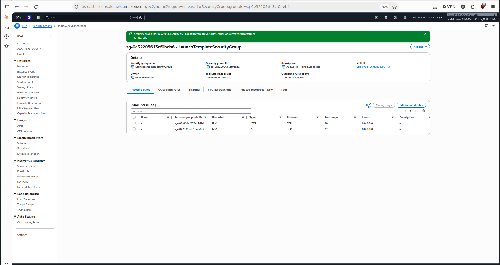

## Task 2 — Target Group

A Target Group is a logical collection of targets. The ALB forwards requests only to the registered targets that are healthy, and the health check verifies that the application on each target responds correctly.

| Setting | Value |
|---|---|
| Name | `LoadBalancerTargetGroup` |
| Target type | Instances |
| Protocol and port | HTTP, port 80 |
| Health check protocol | HTTP |
| Health check path | `/` |
| Health check port | Traffic port (80) |
| Interval | 30 seconds |
| Timeout | 5 seconds |
| Healthy threshold | 5 consecutive successes |
| Unhealthy threshold | 2 consecutive failures |
| Success code | 200 |

### Target Group details

This screenshot was taken straight after creation. The group has no registered targets and no associated load balancer yet, because both were added in later tasks.

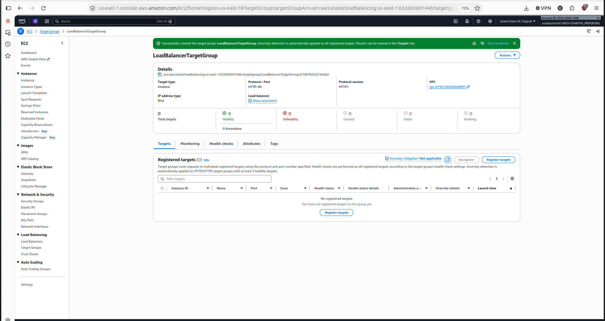

### Health check settings

The **Health checks** tab shows the settings listed in the table above. A target needs to return HTTP 200 for `/` to count as a success.

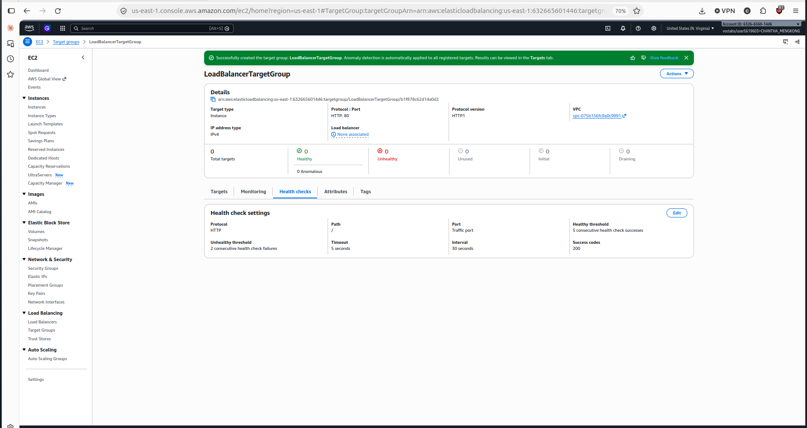

## Task 3 — Application Load Balancer

| Setting | Value |
|---|---|
| Name | `MyLoadBalancer` |
| Type | Application |
| Scheme | Internet-facing |
| IP address type | IPv4 |
| Listener | HTTP, port 80 |
| Default action | Forward to `LoadBalancerTargetGroup` |
| Security Group | `LoadBalancerSecurityGroup` |
| Network | Default VPC, all six Availability Zones (`us-east-1a` to `us-east-1f`) |

Requests flow through the ALB like this:

```text
Internet Client
      |
      | HTTP :80
      v
Application Load Balancer
      |
      v
LoadBalancerTargetGroup
      |
      +------ EC2 Instance 1
      |
      +------ EC2 Instance 2
```

The ALB is a separate AWS-managed resource, not software installed inside an EC2 instance. Clients connect to the ALB's DNS name, and the ALB forwards each request to a healthy target.

### Load balancer list

The list shows `MyLoadBalancer` in the **Active** state, with type `application`, scheme Internet-facing, and IPv4.

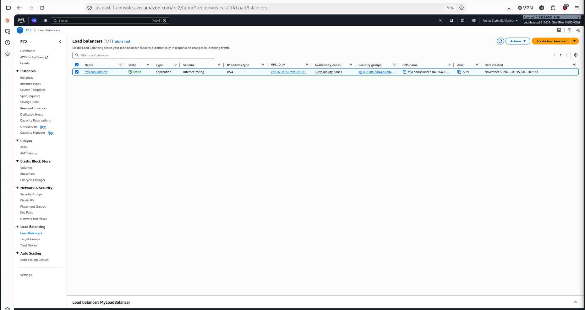

### Load balancer details

The details page shows the six subnets and the DNS name `MyLoadBalancer-848964986.us-east-1.elb.amazonaws.com`. The `HTTP:80` listener forwards 100% of traffic to `LoadBalancerTargetGroup`, with Target Group stickiness off.

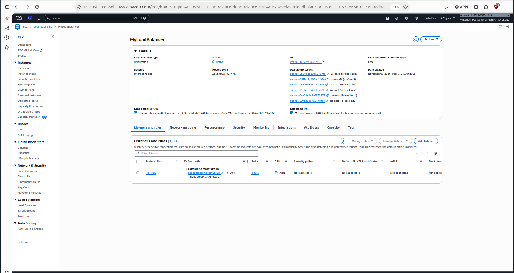

## Task 4 — Launch Template and Auto Scaling Group

### Launch Template

A Launch Template defines how EC2 instances are created and configured.

| Setting | Value |
|---|---|
| Name | `AutoScalingLaunchTemplate` |
| AMI | Amazon Linux 2023 (`ami-0c230065b91270bc6`) |
| Instance type | `t2.micro` |
| Security Group | `LaunchTemplateSecurityGroup` |

The User Data script runs when each instance first boots. It installs and starts Apache HTTP Server (`httpd`), then creates a page that displays the instance's hostname:

```bash
#!/bin/bash
# Enabling admin rights
sudo su
# Updating system and installing httpd
yum update -y
yum install -y httpd.x86_64
# Launching a simple httpd server
systemctl start httpd.service
systemctl enable httpd.service
# Writing HTML file to serve on the httpd server
echo "Hello World from ($(hostname))" > /var/www/html/index.html
```

#### Launch Template User Data

The **Advanced details** tab of `AutoScalingLaunchTemplate` shows the User Data script above. The AMI ID, instance type and Security Group are shown in the ASG details in screenshot 09.

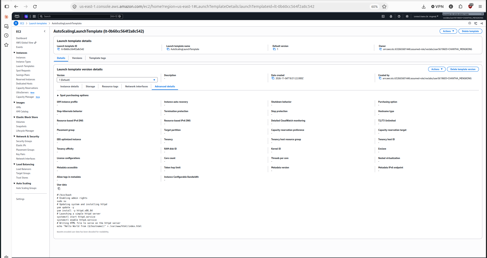

### Auto Scaling Group

The ASG manages the EC2 instances, and the Launch Template provides their configuration. The ASG also registers its instances with the Target Group automatically, so I did not register any targets by hand.

| Setting | Value |
|---|---|
| Name | `MyAutoScalingGroup` |
| Launch Template | `AutoScalingLaunchTemplate` (default version) |
| Desired capacity | 2 |
| Minimum capacity | 2 |
| Maximum capacity | 3 |
| Target Group | `LoadBalancerTargetGroup` (existing) |
| Health check type | EC2, ELB |
| Health check grace period | 300 seconds |
| Network | Default VPC, the same six Availability Zones |

Desired capacity is the normal target number of instances. With ELB health checks enabled, the ASG can respond to targets whose application is unhealthy, not only to EC2 instance failures. During the grace period, a new instance has time to finish booting and running User Data before its health checks count.

#### Auto Scaling Group list

The list shows the capacity values of 2, 2 and 3. I took this screenshot just after creating the group, so its status is *Updating capacity* and it still has 0 instances.

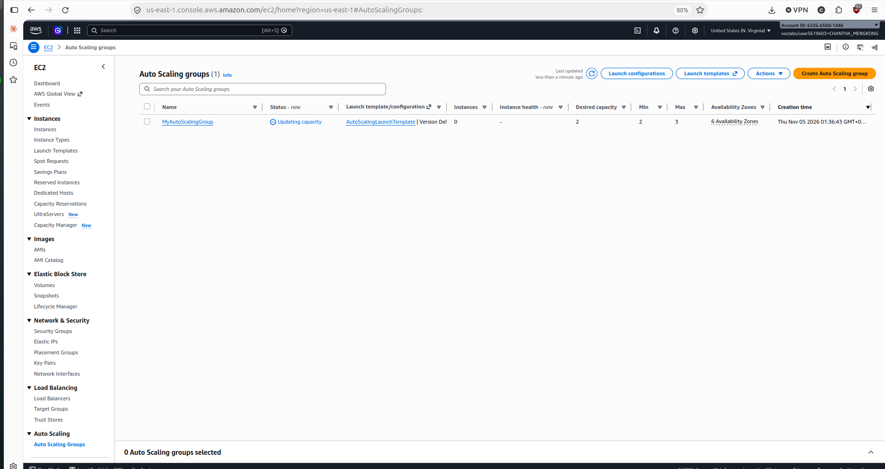

#### Auto Scaling Group details

The details page shows desired capacity 2, scaling limits 2 to 3, the Launch Template with its AMI, `t2.micro` and Security Group ID, the six Availability Zones, and health check type `EC2, ELB`. The Security Group ID `sg-0e32205613cf0beb6` matches `LaunchTemplateSecurityGroup` in screenshot 02.

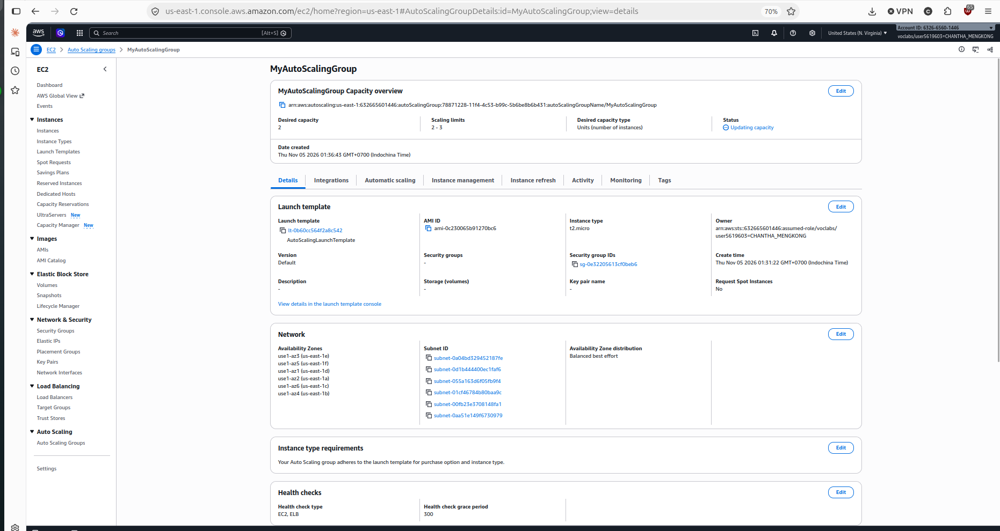

## Task 5 — Testing and Failure Simulation

### Test 1: Load Balancing

I opened the ALB DNS name in a browser:

```text
http://myloadbalancer-848964986.us-east-1.elb.amazonaws.com
```

The ALB received the request and forwarded it to a healthy instance in the Target Group. The page displays `Hello World from (<hostname>)`, so the hostname identifies which instance handled the request.

#### First response

The first response came from `ip-172-31-79-236.ec2.internal`.


#### Second response

After refreshing, the same URL returned a response from a different instance, `ip-172-31-33-5.ec2.internal`. This shows that requests can reach both instances through one address, although not every refresh has to alternate between them.


### Test 2: Simulate an Application Failure

#### Stopping Apache

I connected to instance `i-06cc7853f76a922d8` with EC2 Instance Connect. Its hostname `ip-172-31-79-236` is the one from screenshot 10. I then stopped the web server:

```bash
sudo systemctl stop httpd.service
```

This stops Apache but does not shut down the EC2 instance, which can stay in the `Running` state.

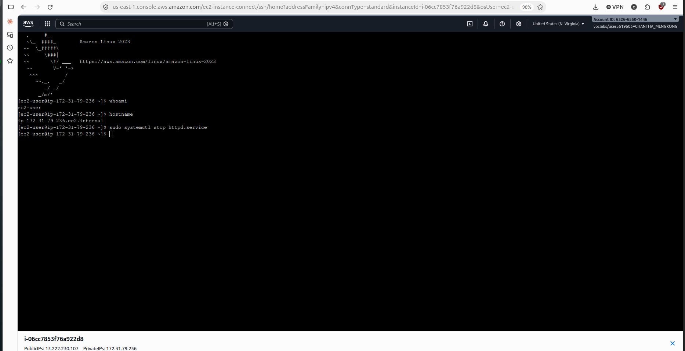

#### Target becomes unhealthy

The Target Group keeps sending HTTP health checks for `/` on port 80. With Apache stopped, nothing answers on that port, so the instance cannot return the expected 200 response. After two consecutive failures, the target is marked `Unhealthy`.

The screenshot shows 2 total targets: `i-06cc7853f76a922d8` is **Unhealthy** with the detail *Health checks failed*, and `i-0bbd11edf1ed39072` is still **Healthy**.

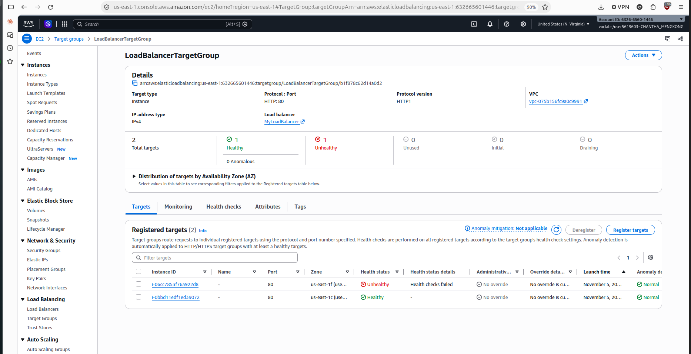

### Test 3: Automatic Instance Replacement

The recovery works in these steps:

1. The Target Group detects that the application is unhealthy.
2. The ASG uses the Elastic Load Balancing health status, because its health check type includes ELB.
3. The ASG identifies the unhealthy instance.
4. The ASG launches a replacement EC2 instance from the Launch Template.
5. User Data installs and starts Apache on the new instance.
6. The replacement instance registers with the Target Group.
7. The Target Group runs health checks on it.
8. Once healthy, the new instance can receive traffic.

#### Replacement instance

The Target Group now has 3 registered targets:

| Instance | Availability Zone | Status |
|---|---|---|
| `i-05db91045b2938f24` | `us-east-1f` | Healthy (the new replacement instance) |
| `i-06cc7853f76a922d8` | `us-east-1f` | Draining (the failed instance, being deregistered) |
| `i-0bbd11edf1ed39072` | `us-east-1c` | Healthy (the instance that was not changed) |

The new instance reached **Healthy** without any manual setup, which shows that the Launch Template and User Data configured it automatically.

**Recorded replacement time:** `1:51 to 1:57`


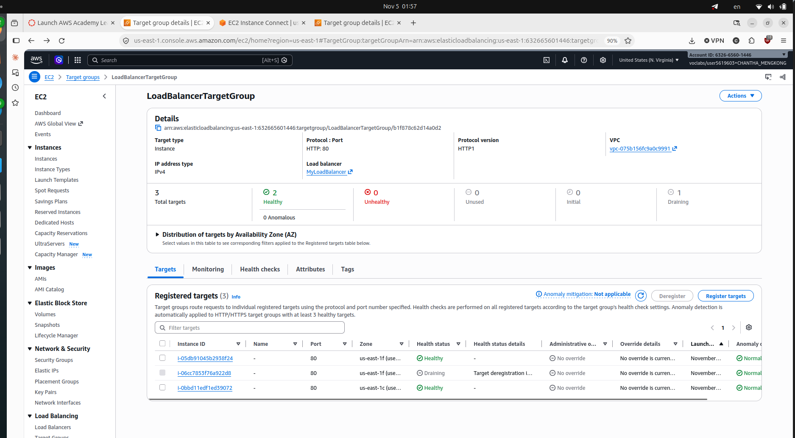

## Cleanup Checklist

After finishing the tests, I deleted the resources created for this lab to avoid unnecessary AWS charges.

- [x] Deleted the Auto Scaling Group (`MyAutoScalingGroup`).
- [x] Terminated the EC2 instances managed by the Auto Scaling Group.
- [x] Deleted the Launch Template (`AutoScalingLaunchTemplate`).
- [x] Deleted the Application Load Balancer (`MyLoadBalancer`).
- [x] Deleted the Target Group (`LoadBalancerTargetGroup`).
- [x] Deleted `LoadBalancerSecurityGroup`.
- [x] Deleted `LaunchTemplateSecurityGroup`.

# Lab Questions and Answers

### Question 1

**Why does the webpage sometimes display a different hostname when you refresh it?**

The ALB distributes incoming HTTP requests across the healthy EC2 instances registered in the Target Group. Each instance has its own hostname, and its page displays that hostname, so the text changes depending on which instance handles the request.

This distribution is not a guarantee of strict round-robin on every refresh. For example, a browser may reuse an existing connection, so the same hostname can appear several times in a row.

### Question 2

**Why can an EC2 instance still be running while its Target Group health status becomes unhealthy after stopping Apache? What exactly does the health check test?**

EC2 instance state and application health are different things:

- **Infrastructure health** is about the virtual machine and its operating system. These kept working after I stopped Apache, so the instance could remain `Running`.
- **Application health** is about whether the web server can respond to requests. This is what failed.

The health check tests the application: it sends an HTTP request to path `/` on port 80 and expects a 200 response. It does not check whether the instance is powered on. With Apache stopped, the request cannot succeed, so the target becomes `Unhealthy` even though the instance is still running.

### Question 3

**Which AWS service detected and replaced the failed EC2 instance? Explain the process.**

The two jobs are done by different components:

- **Target Group (Elastic Load Balancing)** performs the health checks and reports the target as unhealthy. The ALB then stops sending it traffic.
- **Auto Scaling Group (EC2 Auto Scaling)** replaces the instance. Because ELB health checks are enabled, the ASG can use the reported status to identify the unhealthy instance and launch a replacement from the Launch Template.

The ALB does not launch instances. It only routes traffic to healthy targets.

### Question 4

**If the Auto Scaling Group has desired capacity 2, minimum capacity 2, and maximum capacity 3, how many EC2 instances should normally run? Under what circumstances could the number change?**

Normally **two** instances run, because the ASG works to maintain the desired capacity.

- **Minimum capacity 2:** the ASG should not scale below two instances.
- **Desired capacity 2:** the normal target number of instances.
- **Maximum capacity 3:** the ASG cannot scale above three instances.

The number can differ temporarily during replacement or other lifecycle operations. For example, screenshot 14 shows three registered targets for a short time: two healthy and one draining. If a scaling policy is configured, the ASG can also scale between the minimum and maximum values. My screenshots do not show a scaling policy, so I do not claim one was used in this lab.

### Question 5

**The EC2 Security Group currently allows HTTP access from anywhere (`0.0.0.0/0`). How could you improve security so that only the Application Load Balancer can send HTTP requests to EC2 instances?**

Change the inbound HTTP rule in `LaunchTemplateSecurityGroup` so that its source is a Security Group reference instead of an address range.

Instead of:

```text
Type: HTTP
Port: 80
Source: 0.0.0.0/0
```

Use:

```text
Type: HTTP
Port: 80
Source: LoadBalancerSecurityGroup
```

This allows HTTP traffic only from resources associated with `LoadBalancerSecurityGroup`, so arbitrary Internet clients can no longer reach the instances directly on port 80 and must go through the ALB. This is a more secure, production-oriented configuration. I did not apply this change in the lab: screenshot 02 shows the rule as `0.0.0.0/0`.
