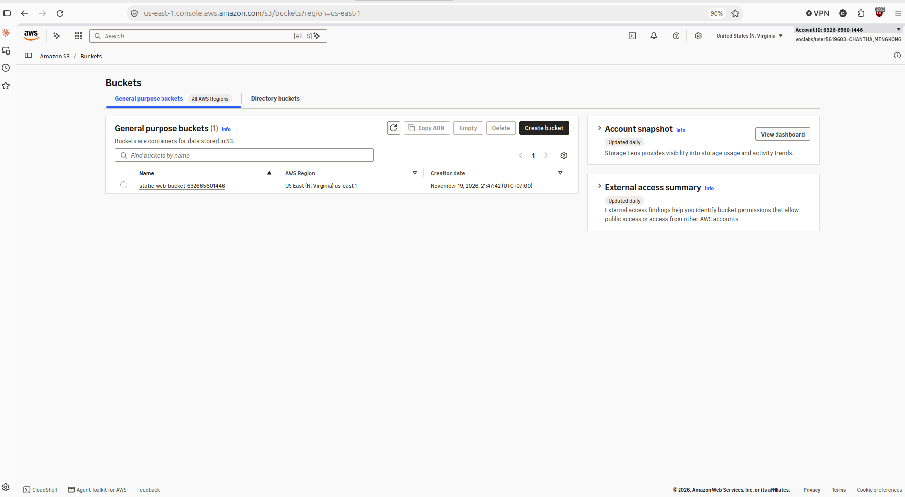
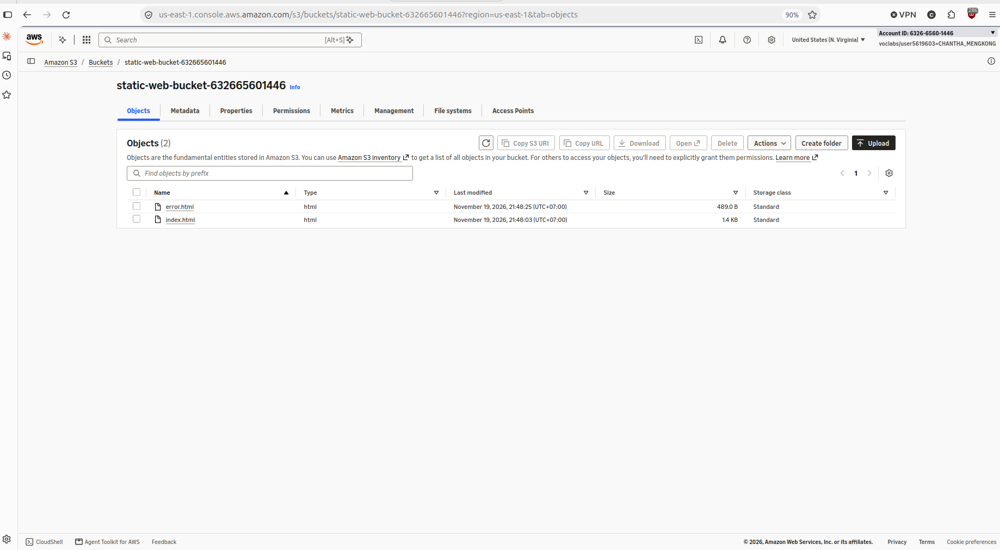
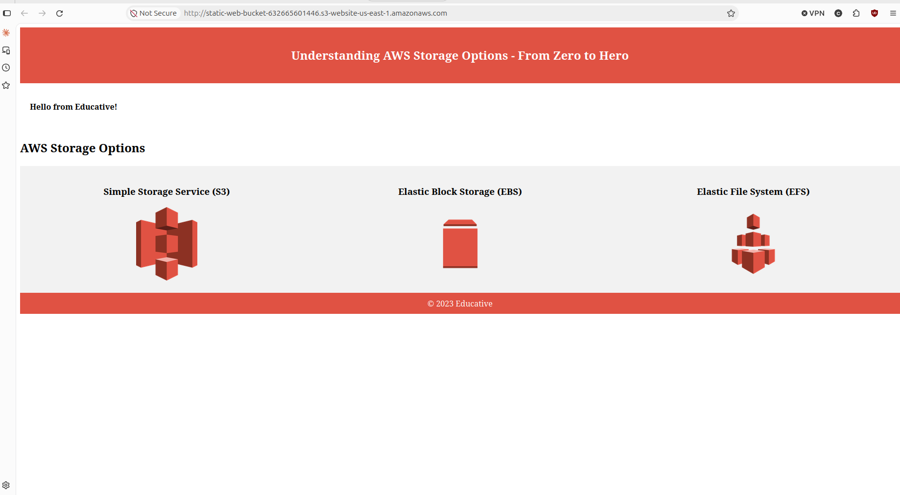
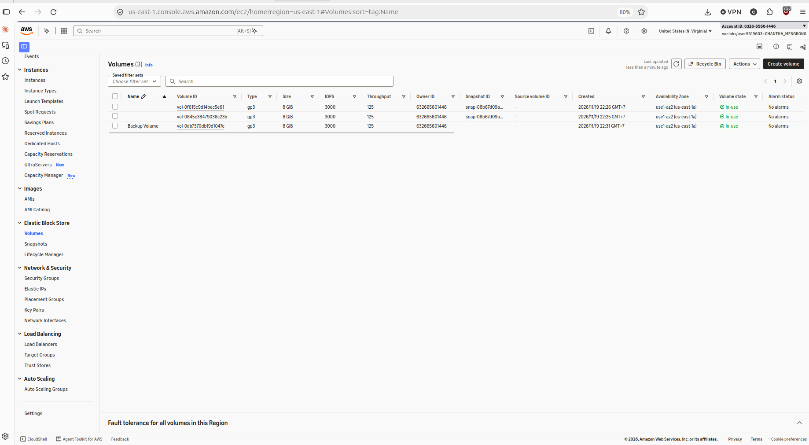
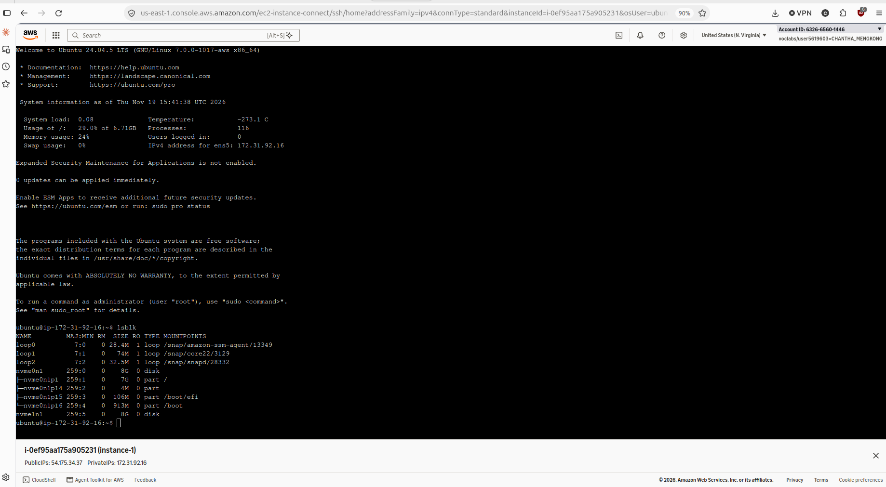
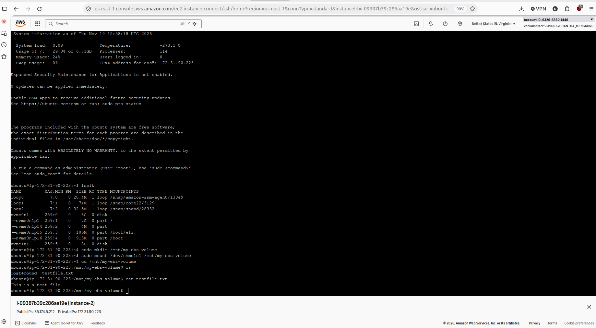
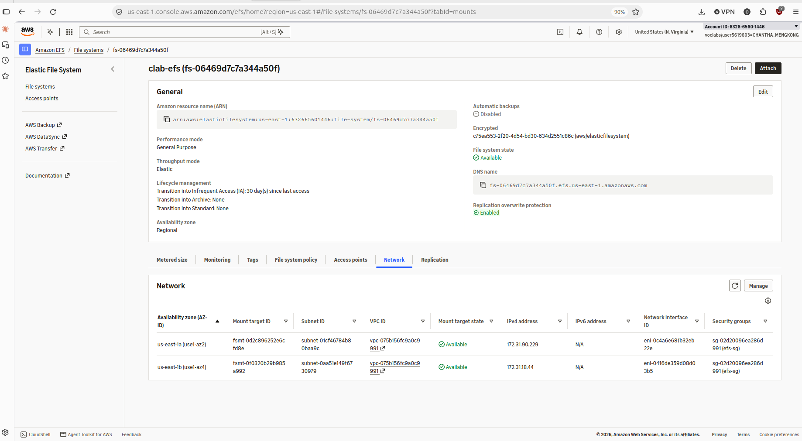
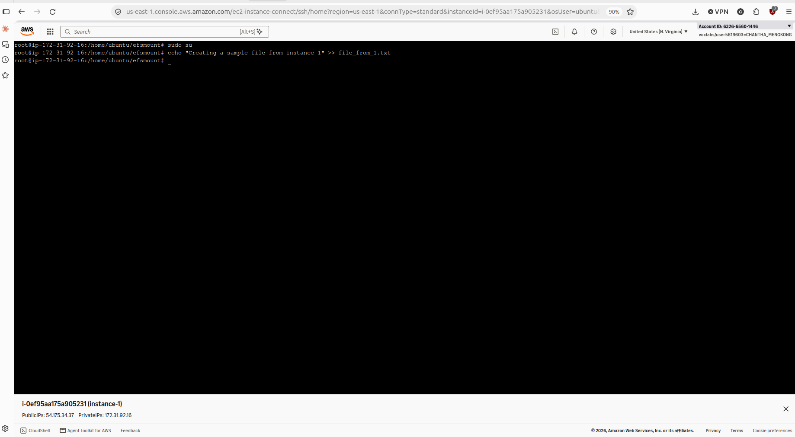
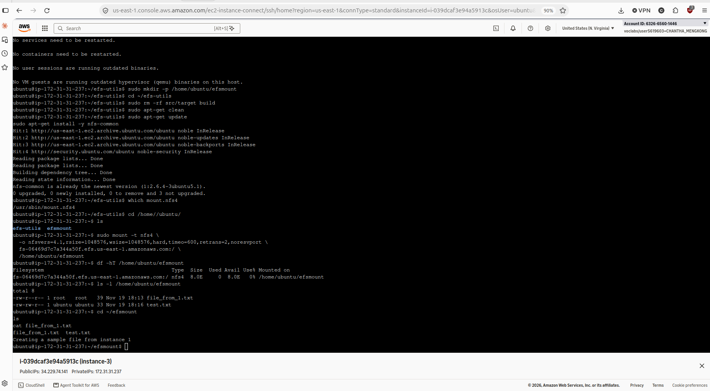

# Cloud Lab 3 Submission — AWS Storage Options

- **Student name:** CHANTHA Mengkong
- **Student ID:** 202221526
- **Learner Lab user name:** voclabs/user5619063=CHANTHA_MENGKONG
- **Date completed:** Thursday, 19 November 2026

All work was done in the AWS Academy Learner Lab, in Region **US East (N. Virginia) `us-east-1`**.

---

## Part 2.1 — Amazon S3

### Bucket list



I created the general purpose bucket `static-web-bucket-632665601446` in `us-east-1`. Bucket names must be globally unique, so the name ends with my account ID.

### Uploaded files



I uploaded the two website files, `index.html` (1.4 KB) and `error.html` (489 B), with the Standard storage class. I then turned on static website hosting with `index.html` as the index document and `error.html` as the error document.

### Static website



The website endpoint `http://static-web-bucket-632665601446.s3-website-us-east-1.amazonaws.com` shows the page *Understanding AWS Storage Options - From Zero to Hero*. The endpoint only works over HTTP, which is why the browser shows *Not Secure*. The page loaded only after I made the objects publicly readable (see Question 1).

---

## Part 2.2 — Amazon EBS

### Volumes page



There are three 8 GiB `gp3` volumes in `us-east-1a`, all *In-use*. Two are the root volumes of the instances, which were created from the AMI snapshot. The third is **Backup Volume** (`vol-0db7370db19d1047e`), the extra volume I created and attached. It has no snapshot ID because it was created empty.

### Attached volume (`lsblk`)



On `instance-1` (Ubuntu 24.04), `lsblk` shows the root disk `nvme0n1` with its partitions, and a second 8G disk, `nvme1n1`, with no partitions and no mount point. That second disk is **Backup Volume**. Before using it, I created a file system on it, mounted it and wrote `testfile.txt`.

Which device name did your volume get (`xvdf`, `nvme1n1`, ...)?

**`nvme1n1`.** These instances present EBS volumes as NVMe devices, so the name chosen in the console does not appear inside Linux. `nvme0n1` is the root volume and `nvme1n1` is the second volume attached.

### File read on instance-2



I detached **Backup Volume** from `instance-1` and attached it to `instance-2`, which is also in `us-east-1a`. An EBS volume can only be attached to instances in its own Availability Zone. On `instance-2` the volume appeared as `nvme1n1` again, and I mounted it without formatting:

```bash
lsblk
sudo mkdir /mnt/my-ebs-volume
sudo mount /dev/nvme1n1 /mnt/my-ebs-volume
cd /mnt/my-ebs-volume
ls
cat testfile.txt
```

`ls` lists `lost+found` and `testfile.txt`, and `cat` prints `This is a test file`. The file written on `instance-1` was still on the volume.

---

## Part 2.3 — Amazon EFS

### File system and mount targets



`clab-efs` (`fs-06469d7c7a344a50f`) is *Available*, with General Purpose performance mode, Elastic throughput and encryption enabled. The **Network** tab shows two mount targets in the default VPC, both using the security group `efs-sg`:

| Availability Zone | Subnet | Mount target IP |
|---|---|---|
| `us-east-1a` | `subnet-01cf46784b80baa9c` | `172.31.90.229` |
| `us-east-1b` | `subnet-0aa51e149f6730979` | `172.31.18.44` |

### File created on instance-1



On `instance-1`, inside the EFS mount directory `/home/ubuntu/efsmount`, I switched to root and created a file:

```bash
sudo su
echo "Creating a sample file from instance 1" >> file_from_1.txt
```

### File listed on instance-3



On `instance-3`, I created the mount directory and mounted `clab-efs` using the standard NFS client (`nfs-common`):

```bash
sudo mkdir -p /home/ubuntu/efsmount
sudo mount -t nfs4 \
  -o nfsvers=4.1,rsize=1048576,wsize=1048576,hard,timeo=600,retrans=2,noresvport \
  fs-06469d7c7a344a50f.efs.us-east-1.amazonaws.com:/ \
  /home/ubuntu/efsmount
df -hT /home/ubuntu/efsmount
ls -l /home/ubuntu/efsmount
cat file_from_1.txt
```

`df -hT` shows the mount as type `nfs4` with a size of `8.0E`. EFS has no fixed size, so it reports a very large value. `ls -l` lists `file_from_1.txt`, owned by `root`, and `cat` prints `Creating a sample file from instance 1`. The file written on `instance-1` was immediately visible on `instance-3`.

---

## Questions

1. After you turned on static website hosting, the endpoint first answered **403 Forbidden**. Why, and what changed after you added the bucket policy?

   Turning on website hosting only gives the bucket a website endpoint. It does not make the objects readable. S3 buckets and objects are private by default, and the browser sends anonymous requests with no AWS credentials. S3 therefore denied the request for `index.html` and returned **403 Forbidden**.

   Adding the bucket policy granted `s3:GetObject` on the bucket's objects to everyone (`"Principal": "*"`). For this to work, Block Public Access had to be turned off for the bucket, because it would otherwise block a public policy. After that, anonymous requests could read the objects, and the endpoint returned the page.

2. `testfile.txt` was still there after you moved **Backup Volume** to `instance-2`. What would have happened to a file saved on `instance-1`'s **root** volume after terminating `instance-1`?

   It would have been lost. A root volume created at launch has **Delete on termination** turned on by default, so AWS deletes it when the instance is terminated, together with every file on it. **Backup Volume** was a separate volume created on its own, so it did not depend on `instance-1`. Detaching it kept its data, which is why `testfile.txt` was still there on `instance-2`.

3. Why did you run `mkfs` on `instance-1` but not on `instance-2`?

   A new EBS volume is an empty block device without a file system, so Linux cannot mount it or store files on it yet. On `instance-1`, `mkfs` created the file system on **Backup Volume**. The file system is stored on the volume itself, so it moved to `instance-2` with the volume. Screenshot 06 shows it already contained `lost+found` and `testfile.txt`. Running `mkfs` again on `instance-2` would have created a new, empty file system and erased `testfile.txt`.

4. Why could `instance-1` and `instance-3` use the EFS file system at the same time, when an EBS volume had to be detached first? Why did they have to be in the subnets of the mount targets?

   EFS is a network file system. Instances access it over the network with the NFS protocol, and EFS manages the file system itself, so many instances can mount it and read and write at the same time. A standard EBS volume such as `gp3` is a block device attached to one instance at a time. The file system on it is managed by that instance's operating system, so it has to be detached before another instance can use it.

   A mount target is a network interface with an IP address in one subnet, and it is how instances reach EFS. The EFS DNS name `fs-06469d7c7a344a50f.efs.us-east-1.amazonaws.com` resolves to the mount target in the instance's own Availability Zone. If there is no mount target there, the mount fails. My mount targets were in `us-east-1a` and `us-east-1b`. `instance-1` (`172.31.92.16`) is in the same range as the `us-east-1a` mount target, and `instance-3` (`172.31.31.237`) is in the same range as the `us-east-1b` mount target. The security group `efs-sg` also has to allow NFS (TCP port 2049) from the instances.

5. For each need, choose S3, EBS or EFS and give one reason: (a) a website's images, (b) the disk of a database server, (c) a folder shared by several web servers.

   | Need | Service | Reason |
   |---|---|---|
   | (a) A website's images | **S3** | It stores files as objects that can be served directly over HTTP, as in Part 2.1, without running a server. |
   | (b) The disk of a database server | **EBS** | It is low-latency block storage attached to one instance, which suits the frequent small reads and writes of a database. |
   | (c) A folder shared by several web servers | **EFS** | Several instances can mount it at the same time, as `instance-1` and `instance-3` did in Part 2.3. |

## Problems and how I solved them (optional)

**Mounting EFS on `instance-3`:** I did not use the `amazon-efs-utils` mount helper. Screenshot 09 shows that I removed its build files (`sudo rm -rf src/target build`) and checked that the standard NFS client was installed (`nfs-common`, with `/usr/sbin/mount.nfs4` present). I then mounted `clab-efs` with `mount -t nfs4` and the NFS options recommended for EFS. The mount worked and showed the file from `instance-1`.

## AI note (optional)

One suggestion an AI tool gave you and how you checked it.

I used an AI assistant (Claude Code) to help write this README from my screenshots. I did the AWS work myself. One suggestion was that the volume would appear as `nvme1n1` rather than `xvdf`, because these instances present EBS volumes as NVMe devices. This was checked against the `lsblk` output in screenshots 05 and 06, which both show the second 8G disk as `nvme1n1`.

## Clean up

- [x] Instances `instance-1`, `instance-2`, `instance-3` terminated.
- [x] `clab-efs` and **Backup Volume** deleted.
- [x] Security groups `efs-sg` and `ec2instances-sg` deleted.
- [x] S3 bucket emptied and deleted.
