# Cloud Lab 4 — Amazon VPC and Networking

## Student Information

- **Student name:** Chantha Mengkong
- **Student ID:** 202221526
- **Learner Lab username:** CHANTHA_MENGKONG
- **Date completed:** 2026-11-05

## VPC and Internet Gateway

In this lab I built a custom VPC in `us-east-1` with one public subnet and one private subnet. I launched an EC2 instance in each subnet and used AWS Systems Manager to test their internet access.

### Architecture

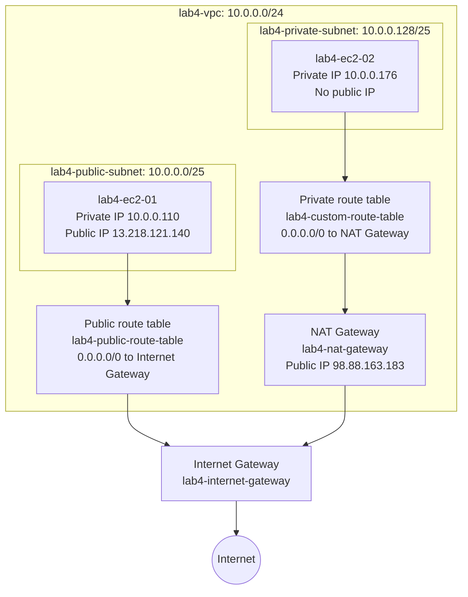

The two network paths are:

```text
lab4-ec2-01 → lab4-public-route-table → Internet Gateway → Internet
lab4-ec2-02 → lab4-custom-route-table → NAT Gateway → Internet Gateway → Internet
```

The NAT Gateway is drawn at VPC level because its console page in screenshot 08 shows *Regional* availability mode and no subnet. Question 3 explains this in more detail.

| Resource | Name | Key configuration |
|---|---|---|
| VPC | `lab4-vpc` | `10.0.0.0/24` |
| Internet Gateway | `lab4-internet-gateway` | Attached to `lab4-vpc` |
| Public subnet | `lab4-public-subnet` | `10.0.0.0/25`, `us-east-1a` |
| Public route table | `lab4-public-route-table` | `0.0.0.0/0` → Internet Gateway |
| Public EC2 instance | `lab4-ec2-01` | `t2.micro`, public IP, IAM role `LabRole` |
| Private subnet | `lab4-private-subnet` | `10.0.0.128/25`, `us-east-1a` |
| NAT Gateway | `lab4-nat-gateway` | Public connectivity, Regional availability mode |
| Private route table | `lab4-custom-route-table` | `0.0.0.0/0` → NAT Gateway |
| Private EC2 instance | `lab4-ec2-02` | `t2.micro`, no public IP, IAM role `LabRole` |

### VPC

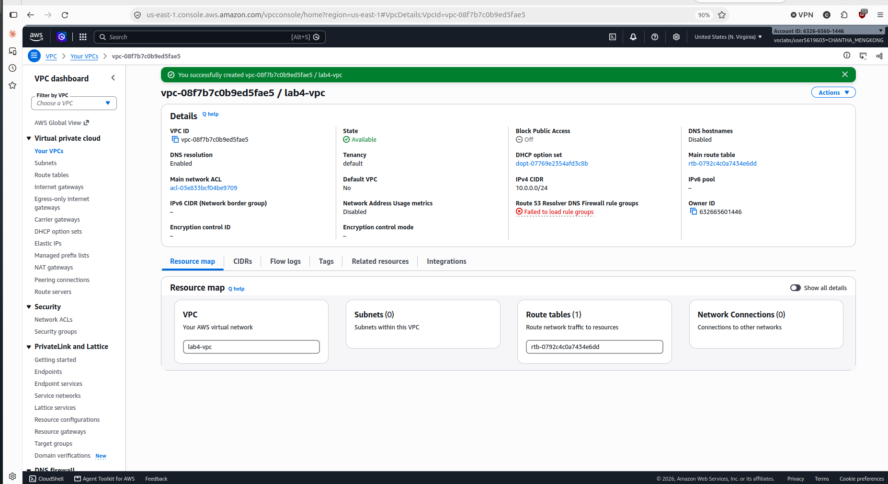

`lab4-vpc` was created in the *Available* state with IPv4 CIDR `10.0.0.0/24`. At this point it had no subnets and only its main route table.

### Internet Gateway

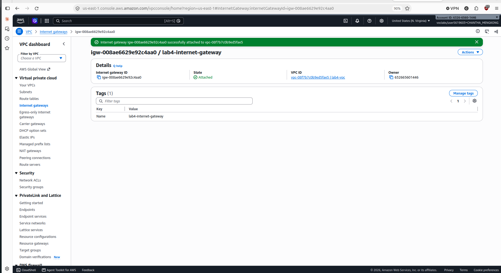

`lab4-internet-gateway` is in the *Attached* state on `lab4-vpc`. Attaching it connects the VPC to the internet, but subnets cannot use it until a route table sends traffic to it.

## Public Subnet

### Subnet

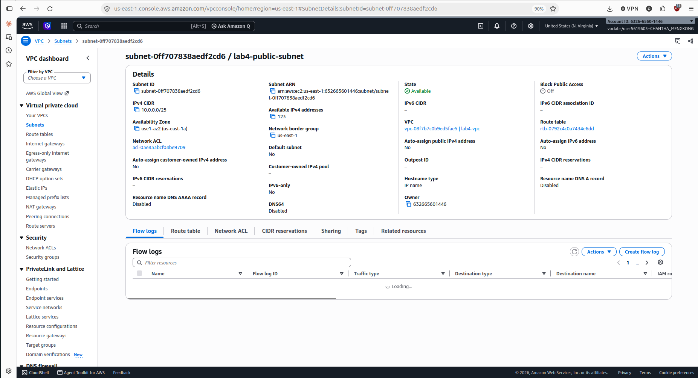

`lab4-public-subnet` uses `10.0.0.0/25` in `us-east-1a` and shows 123 available IPv4 addresses. This screenshot shows the subnet still using the main route table (`rtb-0792c4c0a7434e6dd`), before it was linked to the public route table in the next step.

### Public route table

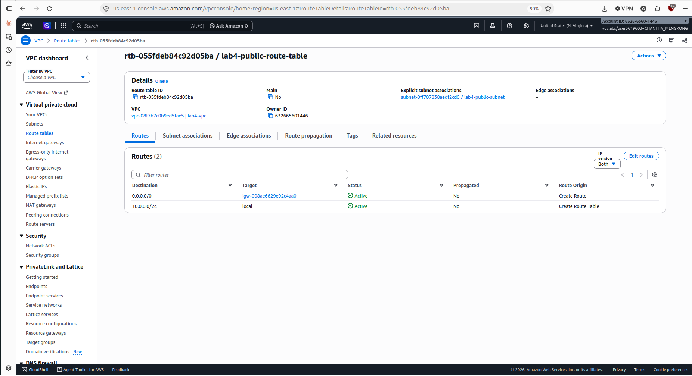

`lab4-public-route-table` is explicitly associated with `lab4-public-subnet`. It has a `local` route for `10.0.0.0/24` and a default route, `0.0.0.0/0`, to the Internet Gateway `igw-008ae6629e92c4aa0`. Both routes are *Active*.

### Public EC2 instance

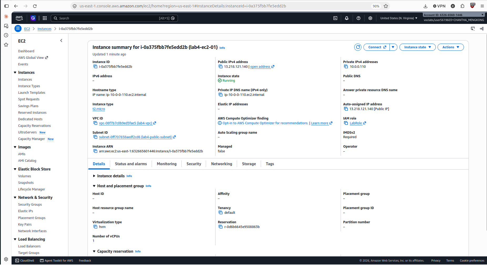

`lab4-ec2-01` is *Running* in `lab4-public-subnet`. It has private IP `10.0.0.110`, auto-assigned public IP `13.218.121.140`, and IAM role `LabRole`.

### Testing the public instance

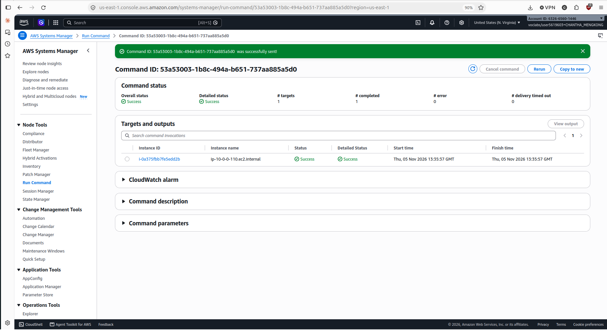

I tested internet access from `lab4-ec2-01` with Systems Manager Run Command. The command to `i-0a375fbb7fe5edd2b` shows an overall status of *Success*, with 1 target completed, 0 errors and 0 delivery timeouts. The screenshot shows the status, not the command text or its output.

## Private Subnet

### Subnet

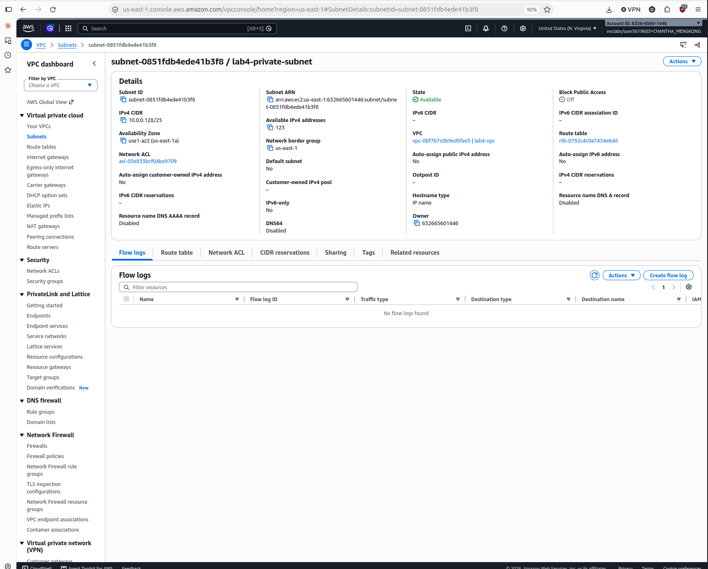

`lab4-private-subnet` uses `10.0.0.128/25` in `us-east-1a` and also shows 123 available IPv4 addresses. Auto-assign public IPv4 is set to *No*. This screenshot also shows the main route table, before the private route table was associated.

### NAT Gateway

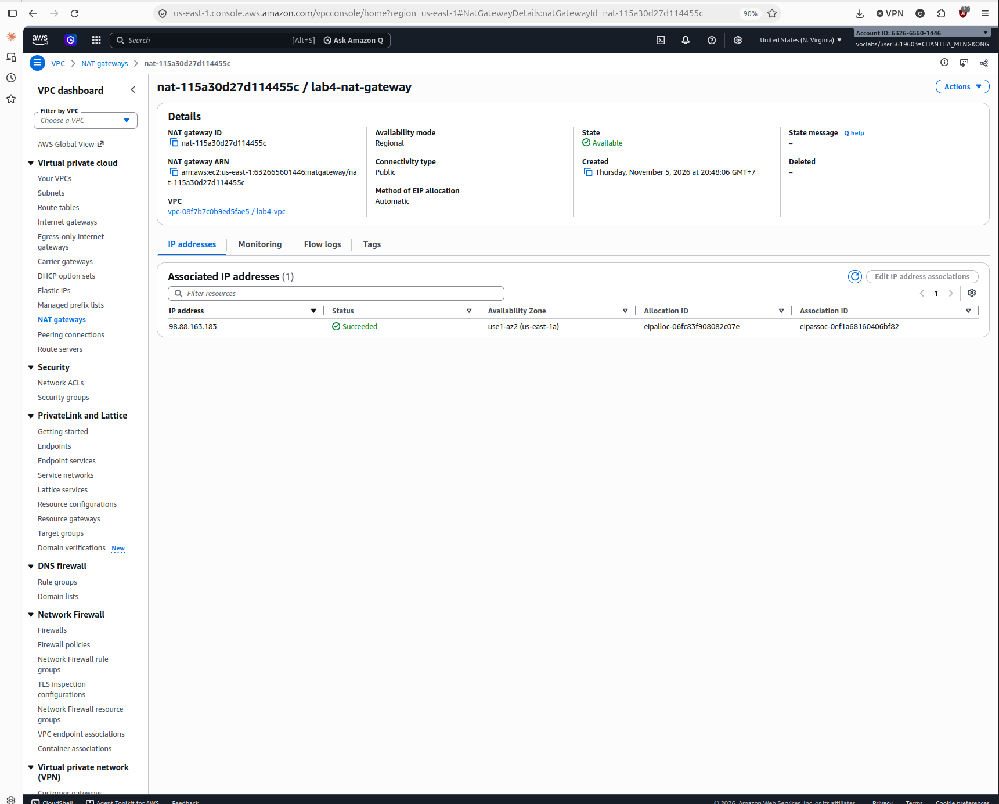

`lab4-nat-gateway` is *Available* in `lab4-vpc` with *Public* connectivity. Its Elastic IP allocation method is *Automatic*, and it has the associated public IP `98.88.163.183`. Its availability mode is *Regional*.

### Private route table

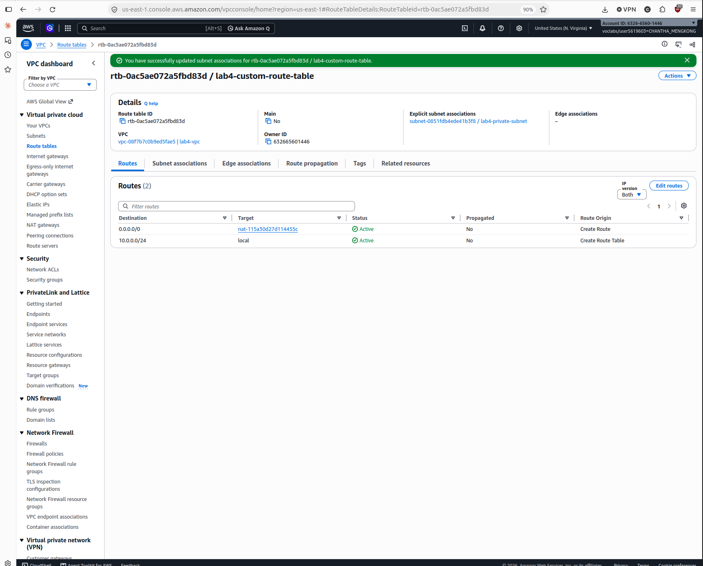

The private route table is named `lab4-custom-route-table` and is explicitly associated with `lab4-private-subnet`. It has a `local` route for `10.0.0.0/24` and a default route, `0.0.0.0/0`, to the NAT Gateway `nat-115a30d27d114455c`. Both routes are *Active*.

### Private EC2 instance

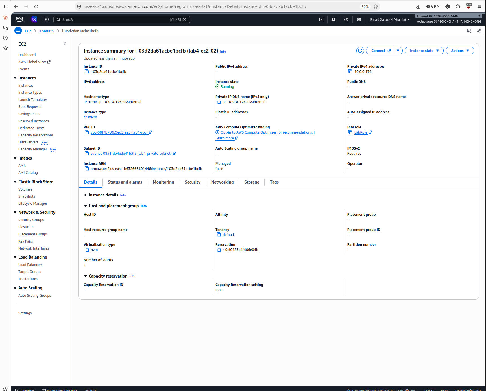

`lab4-ec2-02` is *Running* in `lab4-private-subnet`. It has private IP `10.0.0.176`, IAM role `LabRole`, and no public IPv4 address.

### Testing the private instance

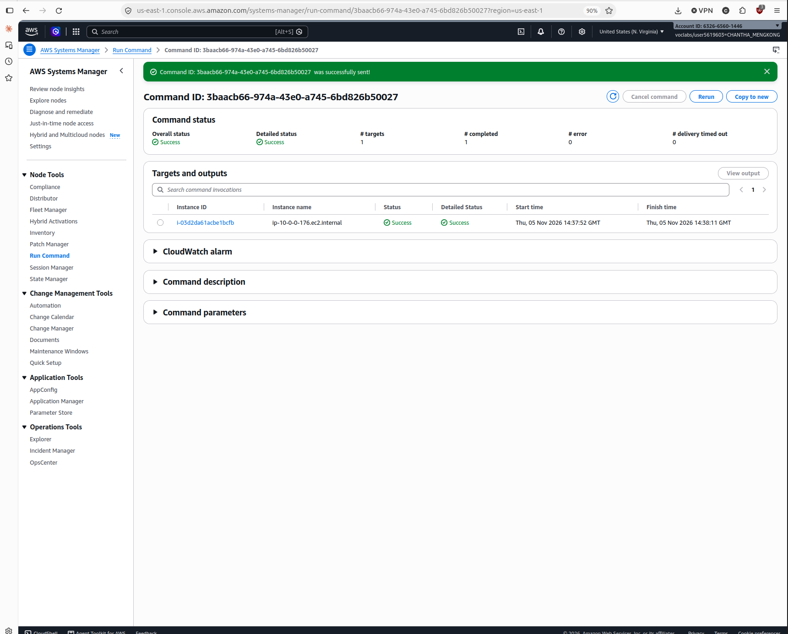

I ran the same type of test on `lab4-ec2-02`. The command to `i-03d2da61acbe1bcfb` shows an overall status of *Success*, with 1 target completed, 0 errors and 0 delivery timeouts. As with screenshot 06, the command text and output are not visible.

## Questions and Answers

### Question 1

**The VPC is `10.0.0.0/24` and the subnets are `10.0.0.0/25` and `10.0.0.128/25`. How many IP addresses does each CIDR block contain, why do the subnets not overlap, and how do total addresses differ from AWS-usable addresses?**

An IPv4 address has 32 bits, so the number of addresses in a CIDR block is 2^(32 − prefix length).

| CIDR block | Address range | Total addresses | AWS-usable addresses |
|---|---|---|---|
| `10.0.0.0/24` (VPC) | `10.0.0.0` to `10.0.0.255` | 256 | Depends on its subnets |
| `10.0.0.0/25` (public subnet) | `10.0.0.0` to `10.0.0.127` | 128 | 123 |
| `10.0.0.128/25` (private subnet) | `10.0.0.128` to `10.0.0.255` | 128 | 123 |

The subnets do not overlap because the public subnet ends at `10.0.0.127` and the private subnet starts at `10.0.0.128`. Together they split the VPC's 256 addresses into two equal halves, with no address in both.

AWS reserves five IPv4 addresses in each subnet: the first four and the last one. In the public subnet these are `10.0.0.0`, `.1`, `.2`, `.3` and `.127`. In the private subnet they are `10.0.0.128`, `.129`, `.130`, `.131` and `.255`. That leaves 128 − 5 = 123 usable addresses per subnet, which matches the 123 available addresses in screenshots 03 and 07.

### Question 2

**Both subnets are in the same VPC. What exactly makes `lab4-public-subnet` public and `lab4-private-subnet` private?**

The difference is the default route in the route table associated with each subnet:

| Subnet | Route table | `0.0.0.0/0` target |
|---|---|---|
| `lab4-public-subnet` | `lab4-public-route-table` | Internet Gateway |
| `lab4-private-subnet` | `lab4-custom-route-table` | NAT Gateway |

`0.0.0.0/0` matches any destination that has no more specific route. Traffic inside the VPC uses the `local` route for `10.0.0.0/24` in both tables, so the default route only decides where internet traffic goes.

A subnet is not public just because its VPC has an Internet Gateway. The gateway is attached to the VPC, but a subnet only uses it if its own route table has a route to it. Both of my subnets were in a VPC with an attached Internet Gateway, yet only the public subnet was given a route to it.

A route alone also does not make an instance reachable. It needs a public IP address too, which `lab4-ec2-01` has and `lab4-ec2-02` does not.

### Question 3

**Why is the NAT Gateway placed in the public subnet instead of the private subnet?**

A NAT Gateway forwards traffic from private resources to the internet, so it needs its own path to the internet. In the standard zonal design, this is why it goes in a public subnet: the subnet's route table sends its traffic to the Internet Gateway. In a private subnet, it would have no direct route out. The private route table would also point `0.0.0.0/0` to a gateway that could not reach the internet itself.

The Elastic IP gives the NAT Gateway a public address. When `lab4-ec2-02` sends a request, the route table sends it to the NAT Gateway, which replaces the private source address `10.0.0.176` with its public IP (`98.88.163.183` in my lab) and sends it out through the Internet Gateway. When the reply returns, the NAT Gateway forwards it back to the instance. The instance gets outbound access without needing a public IP.

My NAT Gateway was in *Regional* availability mode. Screenshot 08 shows it linked to the VPC with no subnet listed, and AWS documentation says a NAT Gateway in this mode does not need a public subnet to host it. The explanation above therefore describes the standard design, while my console shows the Regional version of it.

### Question 4

**`lab4-ec2-02` has no public IP address. Can someone on the internet directly initiate a connection to it? Can it download software updates?**

**Direct connection from the internet: no.** The instance has no public address to connect to, and its private address `10.0.0.176` cannot be routed over the internet. The NAT Gateway does not forward new connections that start from the internet.

**Downloading software updates: yes.** The instance starts the connection, so its traffic follows the default route to the NAT Gateway and then out to the internet. This assumes its security group allows the outbound traffic.

The difference is who starts the connection. A NAT Gateway allows outbound connections started by private resources and returns the replies to those connections. It does not provide inbound access. The private instance can reach out, but the internet cannot reach in.

### Question 5

**You tested internet access with Systems Manager instead of SSH. Why did the instances need `LabInstanceProfile`?**

- **IAM role and instance profile:** An IAM role is a set of permissions. An instance profile is the container that attaches a role to an EC2 instance. Screenshots 05 and 10 show the role `LabRole` on both instances.
- **SSM Agent:** Systems Manager runs commands through the SSM Agent, software on the instance. The agent contacts Systems Manager, receives commands, runs them and sends back the results.
- **Permissions:** The agent uses the temporary credentials from the instance's role to call Systems Manager. Without suitable permissions, the service would reject its requests and could not manage the instance.
- **No SSH key pair:** Run Command does not log in over SSH. The agent makes an outbound connection to Systems Manager, so authentication comes from IAM rather than an SSH key, and the test does not need an inbound SSH connection.
- **Network connectivity:** The IAM role gives the agent permission, but the agent still needs a network path to the Systems Manager service. In my VPC, `lab4-ec2-01` uses the Internet Gateway route and its public IP, and `lab4-ec2-02` uses the NAT Gateway route. This is why the private instance could be managed without a public IP.

## Problems and Solutions

No significant problems were recorded for this lab. Both Run Command tests in screenshots 06 and 11 show *Success*.

## AI Note

I used an AI assistant (Claude Code) to help draft and format this README from my screenshots. I created and tested the AWS resources myself.

One suggestion was to mention that the NAT Gateway page shows *Regional* availability mode and no subnet, because Question 3 describes a NAT Gateway placed in a public subnet. This was checked against my AWS Console screenshot (screenshot 08) and the AWS VPC documentation.

## Cleanup Checklist

I deleted the lab resources after finishing the tests to avoid unnecessary AWS charges.

- [x] Instances terminated.
- [x] NAT gateway deleted and its Elastic IP released.
- [x] Internet gateway detached and deleted.
- [x] `lab4-vpc` deleted.
