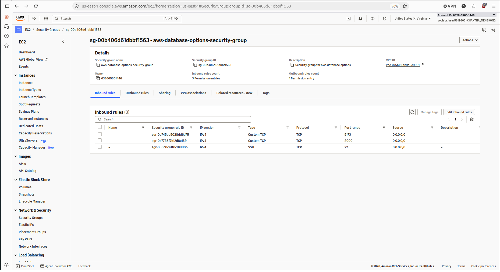
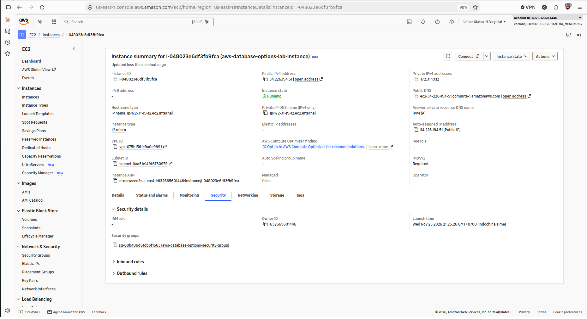
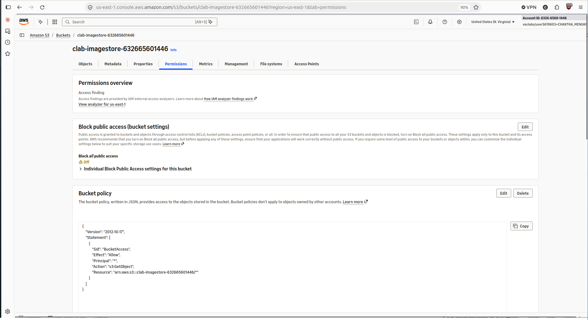
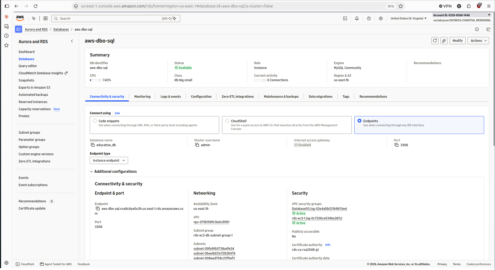
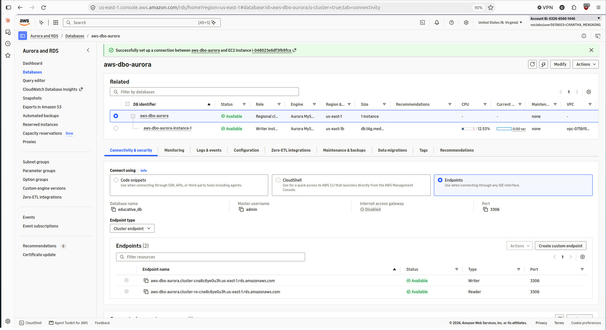
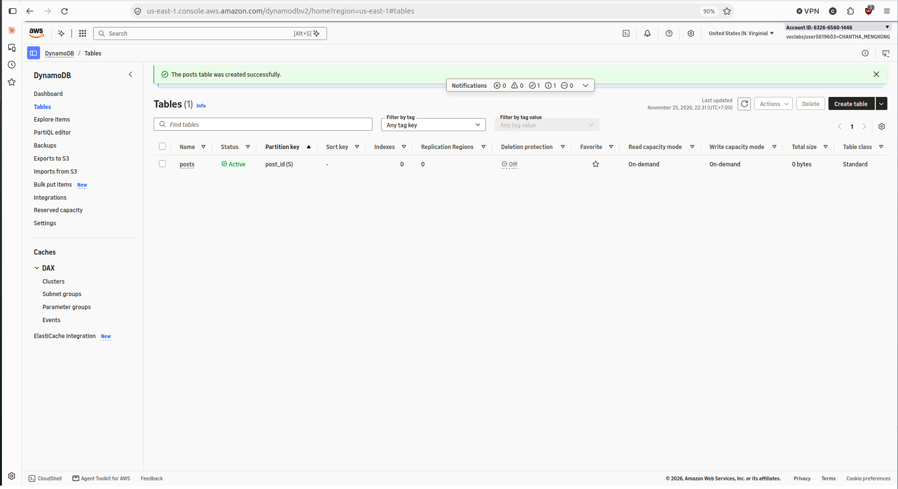
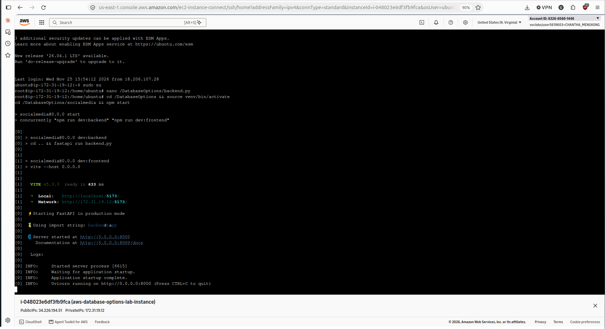
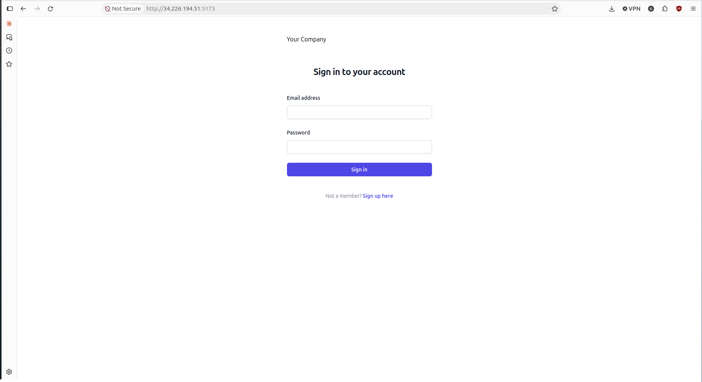
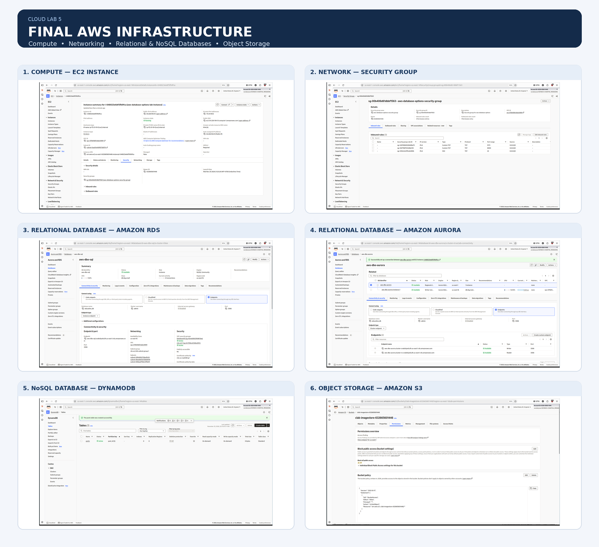

# Cloud Lab 5 Submission — AWS Database Lab

- **Student name:** CHANTHA Mengkong
- **Student ID:** 202221526
- **Learner Lab user name:** CHANTHA_MENGKONG
- **Date completed:** 2026-11-25

All work was done in the AWS Academy Learner Lab, in Region **US East (N. Virginia) `us-east-1`**. No database passwords, AWS access keys, secret keys or session tokens are shown in this report.

In this lab I deployed a social media application on one EC2 instance. Its FastAPI backend (`backend.py`) stores data in four AWS services:

| Service | Resource | What the backend stores there |
|---|---|---|
| Amazon Aurora MySQL | `aws-dbo-aurora` | `users` table: signup writes to the writer endpoint, login reads from the reader endpoint |
| Amazon RDS for MySQL | `aws-dbo-sql` | `user_post` table: post `id` and `username` |
| Amazon DynamoDB | `posts` | Post `title`, `content` and optional `media` URL, keyed by `post_id` |
| Amazon S3 | `clab-imagestore-632665601446` | Uploaded media files, under `posts/<post id>/<file name>` |

---

## 1. Security Group Rules

`aws-database-options-security-group` with its inbound rules (SSH port 22, Custom TCP ports 8000 and 5173) and its outbound rule.



The security group `aws-database-options-security-group` (`sg-00b406d61dbbf1563`) is in VPC `vpc-075b156fc9a0c9991`. It has three inbound rules, all from `0.0.0.0/0`:

| Type | Protocol | Port | Purpose |
|---|---|---|---|
| SSH | TCP | 22 | Connecting to the instance |
| Custom TCP | TCP | 8000 | FastAPI backend |
| Custom TCP | TCP | 5173 | Vite frontend |

The details panel shows **1 outbound permission entry**.

## 2. EC2 Instance Running

`aws-database-options-lab-instance` in the **Running** state with `aws-database-options-security-group` attached.



`aws-database-options-lab-instance` (`i-048023e6df3fb9fca`) is **Running**. Its details:

- **Instance type:** `t2.micro`
- **Public IPv4:** `34.226.194.51`
- **Private IPv4:** `172.31.19.12`
- **Security group:** `sg-00b406d61dbbf1563` (`aws-database-options-security-group`), on the **Security** tab

## 3. S3 Bucket

Your `clab-imagestore-…` bucket with its public access settings and bucket policy visible.



The bucket `clab-imagestore-632665601446` has **Block all public access** turned **Off**. Its bucket policy allows anyone to read the objects:

```json
{
  "Version": "2012-10-17",
  "Statement": [
    {
      "Sid": "BucketAccess",
      "Effect": "Allow",
      "Principal": "*",
      "Action": "s3:GetObject",
      "Resource": "arn:aws:s3:::clab-imagestore-632665601446/*"
    }
  ]
}
```

The backend saves the public object URL of each uploaded file in DynamoDB. This policy lets the browser load those images directly.

## 4. RDS DB Instance

`aws-dbo-sql` with the status **Available** and its endpoint visible.



`aws-dbo-sql` is **Available**. Its details:

- **Engine:** MySQL Community, class `db.t4g.small`, in `us-east-1b`
- **Database name:** `educative_db`
- **Master user name:** `admin`
- **Endpoint:** `aws-dbo-sql.cna8c6ye0u3h.us-east-1.rds.amazonaws.com`, port `3306`
- **Publicly accessible:** No
- **Security groups:** `DatabaseSG` and `rds-ec2-1`

## 5. Aurora DB Status

The `aws-dbo-aurora` cluster with the status **Available** and its writer and reader endpoints visible.



`aws-dbo-aurora` is an **Available** Aurora MySQL regional cluster with **1 instance**. That instance is `aws-dbo-aurora-instance-1`, with the **Writer** role, in `us-east-1b`. The banner confirms that the connection between the cluster and the EC2 instance `i-048023e6df3fb9fca` was set up.

| Endpoint | Type | Port |
|---|---|---|
| `aws-dbo-aurora.cluster-cna8c6ye0u3h.us-east-1.rds.amazonaws.com` | Writer | 3306 |
| `aws-dbo-aurora.cluster-ro-cna8c6ye0u3h.us-east-1.rds.amazonaws.com` | Reader | 3306 |

## 6. DynamoDB Table

The `posts` table with the status **Active** and its partition key `post_id` visible.



The table `posts` is **Active**. Its details:

- **Partition key:** `post_id` (String), with no sort key
- **Capacity mode:** On-demand for reads and writes
- **Table class:** Standard
- **Size:** 0 bytes, because the table had just been created

## 7. Application Configuration and Testing

The EC2 instance terminal after `npm start`, showing that the application started.



First, I set the frontend's backend address. In `/DatabaseOptions/socialmedia/src/Pages/axiosConfig.js`, I replaced `<Your_Instance_PublicIP>` with the instance's public IP, so `baseURL` became `http://34.226.194.51:8000`. Then I edited the configuration at the top of `/DatabaseOptions/backend.py`. I replaced the placeholders with my real values:

- Aurora writer and reader hosts
- RDS host
- database passwords
- Learner Lab credentials
- S3 bucket name

Then I started the application:

```bash
sudo su
nano /DatabaseOptions/backend.py
cd /DatabaseOptions && source venv/bin/activate
cd /DatabaseOptions/socialmedia && npm start
```

`npm start` runs two processes with `concurrently`:

- **Backend `[0]`:** `fastapi run backend.py`. The output shows *Application startup complete* and *Uvicorn running on http://0.0.0.0:8000*.
- **Frontend `[1]`:** `vite --host 0.0.0.0`. The output shows Vite v5.3.3 ready, serving on port `5173`.

The application running in your browser at `http://<Public_IP_of_EC2>:5173`, with the address bar visible.



The browser opens `http://34.226.194.51:5173` and shows the **Sign in to your account** page, with a **Sign up here** link. The frontend can be reached through port 5173 of the security group.

## 8. Final Infrastructure

One collage of the resources you created: EC2 instance, security group, RDS and Aurora databases, DynamoDB table and S3 bucket.



The collage combines screenshots 01–06 in six panels:

1. Compute: the EC2 instance
2. Network: the security group
3. Relational database: RDS
4. Relational database: Aurora
5. NoSQL database: DynamoDB
6. Object storage: S3

## Errors and troubleshooting (optional)

No errors were met during this lab. The terminal in screenshot 07 shows both the backend and the frontend starting normally.

---

## Questions

1. Signup writes to the Aurora **writer** endpoint and login reads from the **reader** endpoint. Your cluster has no Aurora Replica. Which instance answers the reader endpoint, and why does the application still work?

   The reader endpoint is answered by the **writer instance**, `aws-dbo-aurora-instance-1`. It is the only instance in the cluster, as screenshot 05 shows. Normally the reader endpoint (`cluster-ro-…`) balances connections across Aurora Replicas. When a cluster has no replica, Aurora connects the reader endpoint to the primary (writer) instance instead.

   The application still works:
   - `/signup` runs `INSERT INTO users …` on `AURORA_WRITER_HOST`.
   - `/login` runs `SELECT * FROM users WHERE email = %s AND password = %s` on `AURORA_READER_HOST`.

   The writer can run `SELECT` queries as well as writes. Both endpoints reach the same instance and the same cluster storage, so a new user is found as soon as they log in. If a replica were added later, login reads would move to it with no code change.

2. A post is split between the `user_post` table in RDS and the `posts` table in DynamoDB. What does each one store, and how does `/get_posts` join them?

   - **`user_post` (RDS MySQL `aws-dbo-sql`)** stores only the post `id` and the `username` of its author: `INSERT INTO user_post (id, username)`.
   - **`posts` (DynamoDB)** stores the post itself under the same key, `post_id`: the `title`, the `content` and, when a file is uploaded, a `media` URL that points to the object in S3.

   The two databases cannot be joined with SQL, so `/get_posts` joins them in Python:
   1. It runs `SELECT id, username FROM user_post` on RDS.
   2. For each row, it calls `table.get_item(Key={'post_id': id})` on DynamoDB.
   3. It adds the `username` from SQL to the DynamoDB item and appends the result to the list it returns.

   The shared ID is the join key. If one SQL row has no matching DynamoDB item, the code raises an exception. The outer `except` turns this into a **500** error for the whole request, so a single broken post stops all posts from loading.

3. The post ID is the username followed by the time (`%H:%M:%S`). What happens if the same user publishes two posts in the same second, or on two different days at the same time?

   In both cases the two posts get the **same ID**, because `id = str(username) + datetime.now().strftime('%H:%M:%S')` contains no date and no fraction of a second. For example, user `kong` posting at 14:05:09 on Monday and again at 14:05:09 on Tuesday, or twice within one second, gets `kong14:05:09` both times.

   The lab created `user_post` with `id VARCHAR(255) PRIMARY KEY`, so the second post is **rejected**:
   1. `/create_post` first runs `INSERT INTO user_post (id, username)`.
   2. The `id` already exists, so MySQL raises a duplicate-key error.
   3. The `except` block returns **500 "Error creating Post"**.

   The S3 upload and the DynamoDB `put_item` come after the SQL insert, so they never run. The first post stays unchanged, and the second post, with its media file, is lost without a clear reason shown to the user.

   This design has another weakness. If the SQL check were not there, `put_item` with the same `post_id` would **replace** the first DynamoDB item and silently overwrite the first post. A unique ID, such as a UUID or a full date-time with milliseconds, would prevent both problems.

4. Why does the post content go into DynamoDB instead of a SQL table, according to the lab's database design?

   The lab's database design keeps structured data, where every row has the same fields, in SQL: `users` in Aurora and `user_post` in RDS. Posts go in DynamoDB because *"the data for posts can vary from post to post; some posts might not have certain fields, while others may have those fields."*
   - **Different posts have different fields.** A post with media is stored with `title`, `content` and `media`. A post without media has no `media` attribute at all. DynamoDB has no fixed schema, so each item stores only the attributes it needs. A SQL table would need a fixed column, mostly empty, or a schema change for every new field.
   - **Posts are always read by key.** `/get_posts` reads each post with `get_item` on `post_id`. It never needs joins or complex queries on the content. This is the access pattern DynamoDB is built for.
   - **Posts grow quickly in a social media application.** The table uses on-demand capacity (screenshot 06), so it scales with traffic without managing a database server.
   - **SQL keeps the relationship.** The relational databases keep the user accounts and the user–post link, where a fixed schema and SQL queries are useful.

5. The `users` table stores the password exactly as the user typed it, and the S3 bucket allows anyone to read its objects. Name one risk of each choice.

   - **Plain-text passwords:** anyone who can read the `users` table sees every user's real password. In this backend, this is not only a risk from a database leak. `/login` returns `results[0]`, the whole user row including the password, in its response. `GET /all` returns every row of `users` with no authentication at all. Because many people reuse passwords, a leak also exposes their other accounts. Passwords should be stored as salted hashes (bcrypt or Argon2), and the login code should compare hashes.
   - **Public S3 bucket:** the policy grants `s3:GetObject` to `"Principal": "*"`, so anyone with an object URL can download the file without logging in. The keys are easy to guess, because they follow `posts/<username><HH:MM:SS>/<file name>`. A private image uploaded by one user can therefore be found and read by anyone. The account also pays for that traffic. Pre-signed URLs, or CloudFront with restricted access, would limit who can read the files.

## Clean up

- [x] EC2 instance terminated and `aws-database-options-security-group` deleted.
- [x] RDS instance `aws-dbo-sql` and Aurora cluster `aws-dbo-aurora` deleted.
- [x] S3 bucket emptied and deleted.
- [x] DynamoDB table `posts` deleted.
